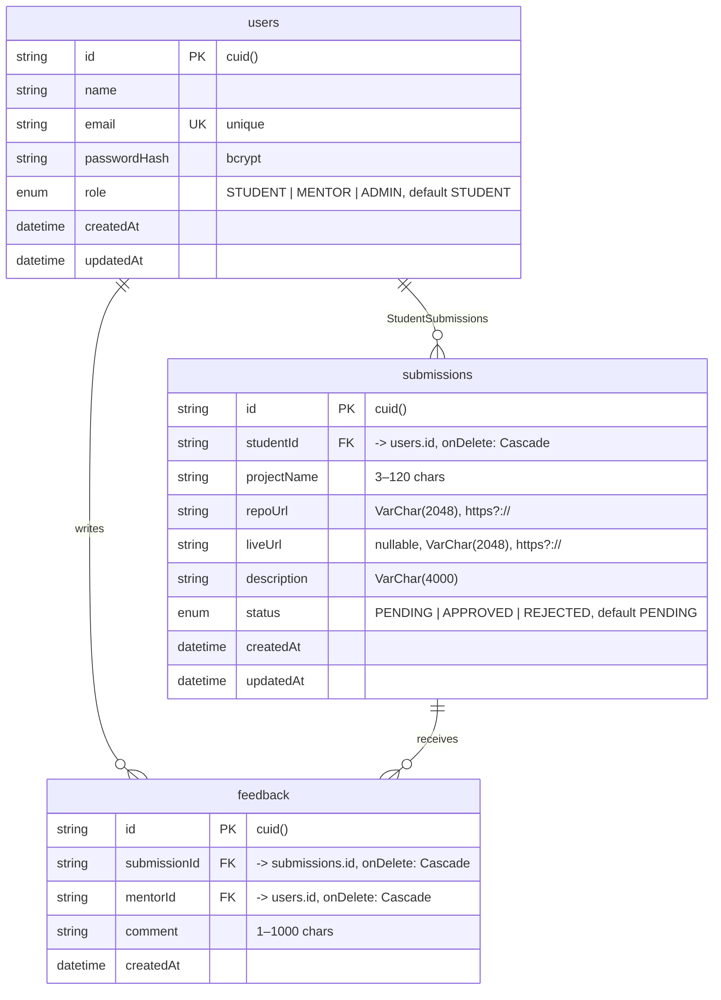

# Submittly — Server-side

The **Submittly API** — an Express 5 + PostgreSQL (Prisma 7) backend that powers student project submissions, mentor review, and role-gated authentication. It was built API-first: every route speaks a documented JSON envelope, validates its input with Zod at the boundary, and authorizes every request independently (clients are never trusted).

> **Spec:** [`../Docs/submittly_project_requirements.md`](../Docs/submittly_project_requirements.md)
> **Client:** [`../Client-side`](../Client-side) — the Next.js frontend that consumes this API
> **Server implementation plan:** `docs/` referenced throughout the code as `docs/implementation-plan.md` (§ references below)

---

## Table of contents

- [Feature overview](#feature-overview)
- [Tech stack](#tech-stack)
- [Requirements](#requirements)
- [Setup](#setup)
- [Environment variables](#environment-variables)
- [Database schema](#database-schema)
- [API reference](#api-reference)
- [Authentication & authorization](#authentication--authorization)
- [Middleware pipeline](#middleware-pipeline)
- [Error handling & the response envelope](#error-handling--the-response-envelope)
- [Rate limiting](#rate-limiting)
- [Business rules](#business-rules)
- [Project structure](#project-structure)
- [Scripts](#scripts)
- [Notes](#notes)

---

## Feature overview

| Area            | What it does                                                                                                                                                  |
| --------------- | ------------------------------------------------------------------------------------------------------------------------------------------------------------- |
| **Auth**        | Student self-signup, login for all roles, HS256 JWT access tokens (`sub` + `role` claims), bcrypt password hashing.                                           |
| **Submissions** | Students submit a project (name, repo URL, optional live link, description) and list **their own** submissions — always scoped by the token, newest first.    |
| **Review**      | Mentors/admins browse **every** submission with server-side status filtering + pagination, generate dashboard counts, and approve/reject pending submissions. |
| **Roles**       | `STUDENT` / `MENTOR` / `ADMIN` enforced by middleware on **every** route — role is embedded in the token but always re-checked against the route's allowlist. |
| **Hardening**   | Helmet, same-origin-friendly CORS allowlist, JSON body cap, global + route-scoped rate limiters, central error renderer that never leaks internals.           |

## Tech stack

| Layer      | Choice                                                                                                                                   |
| ---------- | ---------------------------------------------------------------------------------------------------------------------------------------- |
| Runtime    | **Node.js ≥ 20**, **TypeScript** (strict) with `@/` path aliases (`tsc-alias` at build)                                                  |
| Framework  | **Express 5**                                                                                                                            |
| ORM        | **Prisma 7** (`prisma-client` generator, output inside `src/generated/prisma`) with the **driver adapter** (`@prisma/adapter-pg` + `pg`) |
| Database   | **PostgreSQL**                                                                                                                           |
| Validation | **Zod v4** — parsed at the boundary by the `validate` middleware                                                                         |
| Auth       | **bcryptjs** (12 salt rounds) + **jsonwebtoken** (HS256 access tokens)                                                                   |
| Security   | **helmet**, **cors**, **express-rate-limit** (draft-8 headers, IPv6-safe keying)                                                         |

## Requirements

- **Node.js ≥ 20.9**
- A **PostgreSQL** server reachable via `DATABASE_URL` (e.g. a local Docker instance)

## Setup

```bash
# 1. Install (also runs `prisma generate` via postinstall)
npm install

# 2. Configure
cp .env.example .env
# then edit .env — at minimum DATABASE_URL and JWT_SECRET

# 3. Create the schema and (optionally) seed the admin/mentor accounts
npm run prisma:migrate
npm run prisma:seed

# 4. Run
npm run dev          # tsx watch — hot reload at http://localhost:4000
```

Health check: `GET http://localhost:4000/api/health` →
`{"success":true,"data":{"status":"ok","nodeEnv":"development","uptimeSeconds":N}}`

## Environment variables

| Variable                           | Default                 | Purpose                                                                                       |
| ---------------------------------- | ----------------------- | --------------------------------------------------------------------------------------------- |
| `PORT`                             | `4000`                  | HTTP port                                                                                     |
| `NODE_ENV`                         | `development`           | `development` / `test` / `production`                                                         |
| `DATABASE_URL`                     | —                       | PostgreSQL connection string, read by `prisma.config.ts` (CLI) and the runtime driver adapter |
| `JWT_SECRET`                       | —                       | HMAC secret for access tokens. **Minimum 32 characters — enforced at boot**                   |
| `JWT_EXPIRES_IN`                   | `7d`                    | Token lifetime (values accepted by `jsonwebtoken`)                                            |
| `BCRYPT_SALT_ROUNDS`               | `12`                    | Hashing cost                                                                                  |
| `CORS_ORIGIN`                      | `http://localhost:3000` | Comma-separated allowlist of origins                                                          |
| `RATE_LIMIT_AUTH_MAX`              | `10`                    | Auth attempts per 15-minute window                                                            |
| `RATE_LIMIT_SUBMIT_MAX`            | `5`                     | Submissions per 15-minute window                                                              |
| `ADMIN_EMAIL` / `ADMIN_PASSWORD`   | —                       | Seed account (quote values containing `#`)                                                    |
| `MENTOR_EMAIL` / `MENTOR_PASSWORD` | —                       | Optional seed account to exercise the review dashboard                                        |

`.env` is git-ignored; `.env.example` is committed. Configuration is loaded through `src/config/env.ts`, which validates every variable at boot — a missing/short `JWT_SECRET` fails startup, not the first request.

## Database schema

Three tables, two enums. `users` is the hub: students own submissions, mentors/admins own feedback.



### Constraints & indexes

| Constraint                                        | Why                                                                                                                                                     |
| ------------------------------------------------- | ------------------------------------------------------------------------------------------------------------------------------------------------------- |
| `users.email @unique`                             | One account per email; surfaced as `409 EMAIL_ALREADY_EXISTS`.                                                                                          |
| `@@unique([studentId, repoUrl])` on `submissions` | The documented duplicate rule: **one repo URL per student**. Comparison runs against the _normalized_ repo URL. Surfaced as `409 DUPLICATE_SUBMISSION`. |
| `@@index([status, createdAt])`                    | Serves the mentor queue's status filter + newest-first pagination.                                                                                      |
| `@@index([studentId, createdAt])`                 | Serves the student's own newest-first list.                                                                                                             |
| `@@index([submissionId])` on `feedback`           | Serves any "comments for a submission" lookup.                                                                                                          |
| Cascading deletes                                 | Deleting a user removes their submissions and feedback; deleting a submission removes its feedback.                                                     |

Source of truth: [`prisma/schema.prisma`](./prisma/schema.prisma). The generated client lives in `src/generated/prisma` (committed by `prisma generate`, aliased via `@/generated/prisma/client`).

## API reference

All routes are prefixed with `/api`. Every response uses the envelope described in [Error handling](#error-handling--the-response-envelope): successes are `{ success: true, data }`, failures `{ success: false, message, code, details? }`.

### `auth` — mounted at `/api/auth` (public)

#### `POST /api/auth/signup`

Registers a **student** account (self-service signup is student-only — mentor/admin accounts exist only via seed).

- **Body:** `{ name: string(2–80), email: string(email, lowercased), password: string(8–72, ≥1 letter, ≥1 number) }`
- **Validation:** Zod (`auth.schema.ts`) → `400 VALIDATION_ERROR` with per-field `details[]`
- **201 Created:** `{ user: { id, name, email, role, createdAt }, token }`
- **Errors:** `409 EMAIL_ALREADY_EXISTS`, `429 RATE_LIMITED`

#### `POST /api/auth/login`

- **Body:** `{ email, password }` (email lowercased before comparison)
- **200:** same shape as signup (`token` is an access token for any role)
- **Errors:** `401 AUTH_INVALID` — the same generic message ("Invalid email or password.") for unknown email _and_ wrong password, and a fixed bcrypt comparison against a dummy hash when the email is unknown, so login timing does not leak whether an account exists

### `submissions` — mounted at `/api/submissions` (STUDENT only)

#### `POST /api/submissions`

Creates a submission for the authenticated student.

- **Guards:** `authenticate` → `authorize('STUDENT')` → `submitLimiter` → `validate(body)`
- **Body:** `{ projectName: string(3–120), repoUrl: string(https?://), liveUrl?: string(https?://), description: string(10–4000) }`
- **201 Created:** `{ submission: SubmissionView }` — always created `PENDING` (only mentors change status)
- **Storage behavior:** the repo URL is normalized (`lib/repo-url.ts`: trims, strips `#hash`/`?query`, drops trailing slashes) before insert
- **Errors:** `403 ROLE_FORBIDDEN` (mentors/admins), `409 DUPLICATE_SUBMISSION`, `429 RATE_LIMITED`

#### `GET /api/submissions/me`

Lists the authenticated student's **own** submissions, newest first — scoped by the token's user id, so a student can never read someone else's rows.

- **200:** `{ items: SubmissionView[], total }`
- **Note:** this returns the _entire_ list (no pagination) by design — the client filters locally. Revisit only if individual lists grow large.

### `mentor` — mounted at `/api/mentor` (MENTOR + ADMIN)

#### `GET /api/mentor/submissions?page=1&limit=10&status=PENDING`

Paginated, **server-side filtered** list of every submission with its student.

- **Query:** `page` (int ≥ 1, default 1), `limit` (int 1–50, default 10), `status` (`PENDING` / `APPROVED` / `REJECTED`, optional)
- **200:** `{ items: ReviewSubmission[], page, limit, total, totalPages }`
- **Filtering happens in the database** (`where status`, `skip`/`take`), never in memory

#### `PATCH /api/mentor/submissions/:id/status`

Applies a review decision.

- **Body:** `{ status: 'APPROVED' | 'REJECTED', comment?: string(1–1000) }`
- **Transition rule (documented):** only `PENDING → APPROVED | REJECTED`; `PENDING` is never a target. Re-reviewing is rejected with `422`.
- **Race safety:** the update is **conditional** (`updateMany where status: 'PENDING'`) inside a serializable transaction together with the optional feedback insert — two mentors reviewing simultaneously cannot double-decide.
- **200:** `{ submission: ReviewSubmission }`
- **Errors:** `404 NOT_FOUND`, `422 INVALID_STATUS_TRANSITION`

#### `GET /api/mentor/stats`

Aggregated counts per status via a single `groupBy`.

- **200:** `{ stats: { total, pending, approved, rejected } }`

### Other

| Route             | Description                                  |
| ----------------- | -------------------------------------------- |
| `GET /api/health` | Liveness probe with env + uptime (public).   |
| `*` (unmatched)   | `404 NOT_FOUND` envelope via `not-found.ts`. |

## Authentication & authorization

1. **Signup/login** return a **short-lived HS256 access token** containing `sub` (user id) + `role`, signed with `JWT_SECRET`. Verification checks signature _and_ expiry _and_ the shape of the claims — a forged, expired, or malformed token is always the same unified `401 AUTH_INVALID` (the failure reason is never leaked back to the client).
2. **`authenticate` middleware** reads `Authorization: Bearer <token>`, verifies it, and attaches `req.user = { id, role }`. Missing header → `401 AUTH_REQUIRED`.
3. **`authorize(...roles)` middleware** runs strictly _after_ `authenticate` and yields `403 ROLE_FORBIDDEN` unless `req.user.role` is in the allowlist. This is the real access control — the client's UI gating mirrors it but is UX-only.
4. **Data scoping is token-driven**: no route accepts a "student id" parameter; every student-scoped query derives `studentId` from the verified token.
5. **Controllers never touch `req.user!`** — they call `requireUser(req)`, which throws a typed `401` if the guard chain was bypassed, so TypeScript proves the guard order.

## Middleware pipeline

Composed in `src/app.ts` (the documented order — kept as a factory so tests can mount it without a socket):

```
x-powered-by off → trust proxy (1 hop)
  → helmet()                            security headers
  → cors(origin allowlist)              no browser CORS friction for the client proxy
  → express.json({ limit: '10kb' })     oversized bodies → 400
  → global rate limiter                 1000 req / 15 min, app-wide ceiling
  → /api/health
  → feature routers                     auth → submissions → mentor
  → not-found handler                   404 envelope
  → error handler                       single error-envelope renderer
```

`express.json` errors (malformed/oversized bodies) are recognized by the error handler and rendered as `400 VALIDATION_ERROR` instead of crashing into a 500.

## Error handling & the response envelope

One envelope everywhere (`types/http.ts`):

```json
{ "success": true,  "data": { ... } }
{ "success": false, "message": "human readable", "code": "STABLE_CODE", "details": [...] }
```

`details` is an array of `{ path, message }` produced by Zod validation failures — the client maps them back onto form fields.

Every failure reaching the app boundary is normalized by `middlewares/error-handler.ts` (the **only** place that renders error responses):

| Source                                                       | Mapped to                                                                    |
| ------------------------------------------------------------ | ---------------------------------------------------------------------------- |
| `ApiError` thrown by a service                               | rendered as-is (`status`, `message`, `code`, optional `details`)             |
| `ZodError` (from the validate middleware or schema `.parse`) | `400 VALIDATION_ERROR` + field details                                       |
| Prisma `P2002` unique violation (safety net)                 | `409 DUPLICATE_SUBMISSION`                                                   |
| Body-parser errors (bad JSON / > 10kb)                       | `400 VALIDATION_ERROR`                                                       |
| Express 4xx-class framework errors                           | `400 VALIDATION_ERROR`                                                       |
| Anything else                                                | `500 INTERNAL` — stack is logged **server-side only**, never in the response |

Stable codes (`lib/errors.ts` — mirrored by the client in `types/api.ts`): `AUTH_REQUIRED`, `AUTH_INVALID`, `ROLE_FORBIDDEN`, `VALIDATION_ERROR`, `DUPLICATE_SUBMISSION`, `EMAIL_ALREADY_EXISTS`, `INVALID_STATUS_TRANSITION`, `RATE_LIMITED`, `NOT_FOUND`, `INTERNAL`.

## Rate limiting

Three limiters (`middlewares/rate-limiter.ts`), all 15-minute windows, standard `RateLimit-*` draft-8 headers, no legacy headers:

| Limiter         | Scope                                      | Limit                       | Keying                              |
| --------------- | ------------------------------------------ | --------------------------- | ----------------------------------- |
| `globalLimiter` | every request                              | 1000 / window               | IP (IPv6-safe via `ipKeyGenerator`) |
| `authLimiter`   | `POST /api/auth/signup`, `/api/auth/login` | `RATE_LIMIT_AUTH_MAX` (10)  | user id when present, else IP       |
| `submitLimiter` | `POST /api/submissions`                    | `RATE_LIMIT_SUBMIT_MAX` (5) | user id when present, else IP       |

User-keyed windows mean several students behind one NAT don't exhaust each other's budgets once they're signed in. Tripping any limiter produces `429 RATE_LIMITED`.

## Business rules

The rules the servers owns and the database enforces:

1. **One repo URL per student.** `@@unique([studentId, repoUrl])` after normalization — resubmitting the same repository (even with a different trailing slash or hash/query) is `409 DUPLICATE_SUBMISSION`. Different students submitting the same project is allowed.
2. **Submissions start `PENDING` — always.** Clients cannot set the status; the schema default owns it.
3. **Single review, final.** The only legal transition is `PENDING → APPROVED` or `PENDING → REJECTED`. Reviewed submissions are immutable (`422 INVALID_STATUS_TRANSITION`), enforced both by a pre-check and by a race-safe conditional update in the write transaction.
4. **Self-registration is student-only.** The signup route hard-codes `role: 'STUDENT'`; mentors/admins come from the seed only.
5. **Password policy:** 8–72 chars, ≥ 1 letter, ≥ 1 number; hashed with bcrypt (`BCRYPT_SALT_ROUNDS`, default 12). Passwords are never logged or echoed back.
6. **Validation is authoritative server-side.** The client re-implements the same Zod contracts for UX only.

## Project structure

```
src/
├── app.ts                         # Express app factory — middleware chain + router mounting
├── server.ts                      # listen loop (separate so tests can mount createApp())
├── config/env.ts                  # boot-time env validation (JWT_SECRET length enforced)
├── db/prisma.ts                   # Prisma client wired to the pg driver adapter
├── features/                      # vertical slices — routes → controller → schema → service
│   ├── auth/                      # signup, login (public routes)
│   ├── submissions/               # student create + list-mine (STUDENT)
│   └── review/                    # list + review + stats (MENTOR/ADMIN)
├── generated/prisma/              # generated client (import via @/generated/prisma/client)
├── lib/
│   ├── errors.ts                  # ApiError + stable error codes
│   ├── jwt.ts                     # sign/verify HS256 access tokens
│   ├── password.ts                # bcrypt hash/verify
│   └── repo-url.ts                # repo URL normalization for the duplicate rule
├── middlewares/
│   ├── authenticate.ts            # Bearer token → req.user (+ requireUser)
│   ├── authorize.ts               # role allowlists → 403
│   ├── validate.ts                # Zod parses body/query/params, strips unknown keys
│   ├── rate-limiter.ts            # global/auth/submit limiters
│   ├── error-handler.ts           # one envelope renderer, 500s logged server-side only
│   └── not-found.ts               # 404 envelope
└── types/
    ├── http.ts                    # ApiSuccess/ApiErrorEnvelope
    ├── role.ts                    # Role + SubmissionStatus
    └── express.d.ts               # req.user augmentation
prisma/
├── schema.prisma                  # User / Submission / Feedback + enums
├── migrations/                    # versioned SQL migrations
└── seed.ts                        # ADMIN (+ optional MENTOR) from env
```

## Scripts

| Script                            | What it does                                         |
| --------------------------------- | ---------------------------------------------------- |
| `npm run dev`                     | `tsx watch src/server.ts` — hot reload               |
| `npm run build`                   | `prisma generate` → `tsc` → `tsc-alias` (dist build) |
| `npm run start`                   | Serve the built app (`dist/server.js`)               |
| `npm run typecheck`               | `prisma generate && tsc --noEmit`                    |
| `npm run lint`                    | ESLint (flat config)                                 |
| `npm run format` / `format:check` | Prettier write / CI check                            |
| `npm run prisma:generate`         | Regenerate the client into `src/generated/prisma`    |
| `npm run prisma:migrate`          | Create/apply dev migrations (`prisma migrate dev`)   |
| `npm run prisma:deploy`           | Apply migrations in production                       |
| `npm run prisma:seed`             | Seed the admin/mentor accounts from env              |
| `npm run prisma:studio`           | Prisma Studio data browser                           |

`postinstall` runs `prisma generate` so a fresh clone is immediately typecheckable.

## Notes

- **Prisma 7 specifics:** the connection URL lives in `prisma.config.ts` (CLI) and the runtime **driver adapter** (`@prisma/adapter-pg`) — the schema no longer carries `url`. The generated client output is inside `src/` on purpose so it compiles with the app under the `@/` alias.
- **The app factory is split from the listener** (`createApp()` vs `server.ts`) so integration tests can mount the app without binding a port (Phase 7 of the plan).
- **Trust proxy is 1 hop** — rate limiting keys on real client IPs behind nginx/Render/Vercel rather than the proxy address.
- **The JSON body cap is 10kb** — the API's payloads are small by contract; submissions cap at a 4000-character description.
- **Upstream status codes are passed through as-is** to the proxying client; the client mirrors `ApiErrorCode` 1:1.
